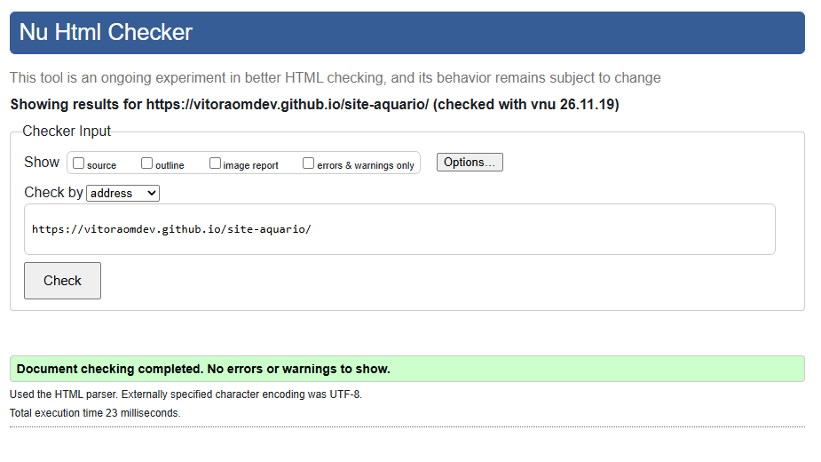

Peixes de Aquário — Atividade 1 (HTML Semântico)

Tema: Peixes de Aquário
**Site publicado:** https://SEU-USUARIO.github.io/NOME-DO-REPOSITORIO/

 O que foi feito na Atividade 1
- Estrutura semântica com `header`, `nav`, `main`, `aside` e `footer`
- 3 `article` com `figure` + `figcaption` (imagens com `alt`, `width` e `height`)
- Tabela com `caption`, `thead`, `tbody` e `th scope`
- Formulário de contato com `label`, `fieldset`/`legend` e tipos corretos
- Uso de `time`, `address`, `strong` e `em`; link "Pular para o conteúdo"
- CSS externo simples e responsivo

Validação W3C
Print do resultado em https://validator.w3.org/nu (zero erros):

